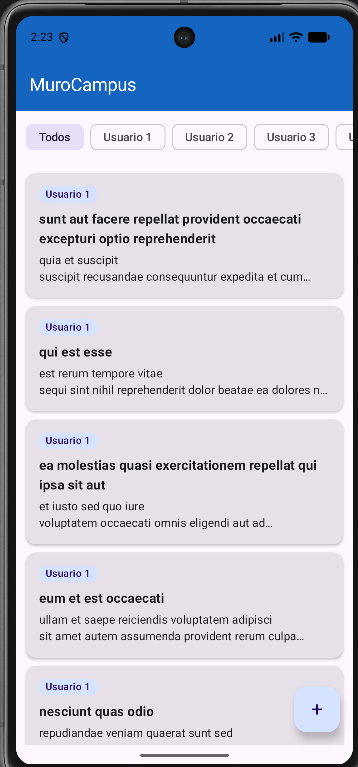
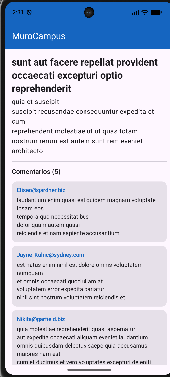
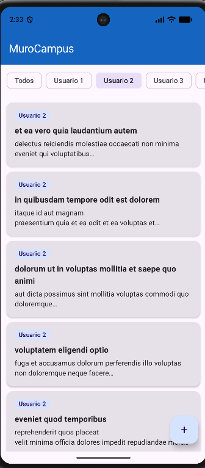
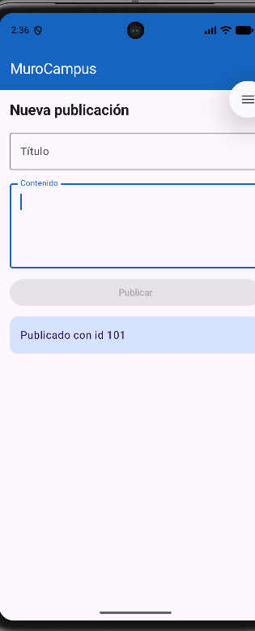
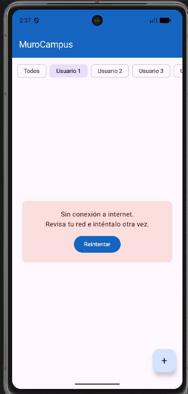

# MuroCampus

**Laboratorio GLAB-S09 · Servicios Web y plataforma REST · Programación en Móviles (Tecsup)**

MuroCampus es una app Android (Kotlin + Jetpack Compose) que consume el servicio web REST
[JSONPlaceholder](https://jsonplaceholder.typicode.com/). La app:

- **Lista** las publicaciones (`GET posts`).
- Muestra el **detalle con sus comentarios** (`GET posts/{id}` y `GET posts/{id}/comments` con `@Path`).
- **Filtra por usuario** con una fila de chips (`GET posts?userId=N` con `@Query`).
- **Crea una publicación nueva** (`POST posts` con `@Body`).
- Se comporta bien **sin internet**: muestra el error y el botón **Reintentar**.

> Los textos de las publicaciones están en latín de relleno (*lorem ipsum*): así los devuelve JSONPlaceholder.

## Tecnologías

- Kotlin, Jetpack Compose y Material 3
- Retrofit 2.11 + conversor kotlinx.serialization
- OkHttp 4.12 + HttpLoggingInterceptor (tráfico visible en Logcat)
- ViewModel + StateFlow + `collectAsStateWithLifecycle`
- Corrutinas (`viewModelScope`, `async` dentro de `coroutineScope`)

## Estructura de paquetes

```
com.ortiz.murocampus/
├── MainActivity.kt              Navegación simple (lista / detalle / crear) y BackHandler
├── model/
│   └── Modelos.kt               Post, Comentario, NuevoPost (+ Usuario de ejemplo)
├── data/
│   ├── remote/
│   │   ├── PostApi.kt           Interface de Retrofit (@GET, @POST, @Path, @Query, @Body)
│   │   └── RetrofitClient.kt    Cliente único: baseUrl, OkHttp, conversor JSON
│   ├── PostRepository.kt        Interface + PostRepositoryRemote (todo devuelve Result)
│   └── MensajesError.kt         mensajeDe(): traduce la excepción a un texto
├── viewmodel/
│   ├── UiState.kt               Cargando / Exito / Error
│   ├── PostsViewModel.kt        Lista, detalle, filtro y crear
│   └── PostsViewModelFactory.kt
└── ui/
    ├── Componentes.kt           TarjetaPost, Cargando, ErrorConReintento
    ├── PantallaLista.kt         Chips de filtro + lista
    ├── PantallaDetalle.kt       Publicación y comentarios
    ├── PantallaCrear.kt         Formulario para publicar
    └── theme/
```

## Arquitectura MVVM + Repository

```
┌──────────────────────┐   eventos (cargar, abrir, filtrar, publicar)
│      View (ui/)      │ ─────────────────────────────────────────────┐
│  Composables         │                                              ▼
│  when (UiState)      │ ◄── StateFlow<UiState> ──  ┌──────────────────────────┐
└──────────────────────┘   (Cargando/Exito/Error)   │ ViewModel (PostsViewModel)│
                                                    │ Result → UiState          │
                                                    └─────────────┬────────────┘
                                                                  │ suspend fun → Result<T>
                                                                  ▼
                                                    ┌──────────────────────────┐
                                                    │ Repository (PostRepository)│
                                                    │ try/catch → Result        │
                                                    └─────────────┬────────────┘
                                                                  │
                                                                  ▼
                                                    ┌──────────────────────────┐
                                                    │ data/remote: PostApi      │
                                                    │ Retrofit + OkHttp + JSON  │
                                                    └─────────────┬────────────┘
                                                                  ▼
                                                     jsonplaceholder.typicode.com
```

| Capa | Conoce a | No debe |
|------|----------|---------|
| View (`ui/`) | Solo a su ViewModel | Llamar a Retrofit ni conocer PostApi |
| ViewModel | Solo a la interface `PostRepository` | Conocer Retrofit, HttpException ni Context |
| Repository | PostApi y las excepciones de red | Conocer la UI ni dejar escapar excepciones |
| data/remote | Retrofit, OkHttp y el JSON | Guardar estado de pantalla |

## Capturas

| Lista | Detalle | Filtro (Usuario 2) |
|:---:|:---:|:---:|
|  |  |  |

| Crear | Error de conexión |
|:---:|:---:|
|  |  |

## Pruebas de errores

| Prueba | Cómo provocarla | Resultado esperado | OK |
|--------|-----------------|--------------------|:--:|
| Sin internet | Modo avión y abrir la app | **Sin conexión a internet** y botón **Reintentar** | ✅ |
| Reintentar | Quitar modo avión y pulsar **Reintentar** | Carga la lista | ☐ |
| Recurso inexistente | `posts/9999` en detalle (temporal) | **Error del servidor (404)** | ☐ |
| JSON inesperado | Quitar / agregar un campo en Post (temporal) | Funciona / **Respuesta inesperada** | ☐ |
| Cancelación | Abrir el detalle y volver rápido | Sin errores en Logcat | ☐ |
| Lista y detalle | Abrir varias publicaciones | Siempre 5 comentarios | ✅ |
| Filtro | Elegir cada usuario | Siempre 10 publicaciones | ✅ |
| Crear | Enviar una publicación | **Publicado con id 101** | ✅ |
| Código | Revisar `viewmodel/` | Sin Retrofit, PostApi ni HttpException | ☐ |

## Para pensar

**1. ¿Qué diferencia hay entre GET y POST? ¿Por qué crear lleva @Body y porUsuario lleva @Query?**
GET solo *pide* datos y no cambia nada en el servidor; POST *envía* datos para crear algo nuevo.
`crear` lleva `@Body` porque la publicación nueva viaja como JSON en el cuerpo de la petición.
`porUsuario` lleva `@Query` porque el usuario es solo un filtro que va en la URL (`posts?userId=2`); un GET no lleva cuerpo.

**2. ¿Por qué la ruta es "posts" y no "/posts"?**
Retrofit une la ruta con la `baseUrl`. Una ruta que empieza con `/` es absoluta: reemplaza todo el camino de la URL base
y se quedaría solo con el dominio. Con `"posts"` (relativa) se agrega al final de `https://jsonplaceholder.typicode.com/`,
por eso la `baseUrl` termina en `/`.

**3. ¿Por qué el Repository devuelve Result en vez de dejar que la excepción llegue al ViewModel?**
Así el ViewModel no necesita `try/catch` ni conocer `IOException` o `HttpException` (que son de Retrofit).
El fallo se vuelve un valor normal que el ViewModel convierte en `UiState.Error`, la app nunca se cierra por una
excepción de red y se puede cambiar la fuente de datos (por ejemplo Room) sin tocar el ViewModel ni la pantalla.

**4. ¿Qué pasa si olvidas el permiso INTERNET? ¿Y si olvidas ignoreUnknownKeys y el servidor agrega un campo nuevo?**
Sin el permiso INTERNET, Android bloquea el socket y toda llamada falla (`SecurityException` / `UnknownHostException`),
así que siempre se vería el error. Sin `ignoreUnknownKeys`, si el servidor agrega un campo que no está en la data class,
kotlinx.serialization lanza `SerializationException` y la app muestra **Respuesta inesperada** aunque los datos estén bien.

**5. ¿Por qué la pantalla de lista usa un when sobre UiState y no un if con tres variables?**
Porque `UiState` es una `sealed interface`: la pantalla solo puede estar en **un** estado a la vez y el compilador obliga
a manejar los tres casos. Con tres variables (`cargando`, `datos`, `error`) se podrían dar combinaciones imposibles,
como cargando y error a la vez, y es fácil olvidar un caso.

**6. JSONPlaceholder no guarda los POST. ¿Cómo cambiaría tu app si usaras un servicio real?**
La publicación creada sí quedaría guardada, así que después de publicar habría que actualizar la lista
(volver a llamar a `listar()` o agregar el post devuelto a la lista). Además, habría que manejar autenticación
(por ejemplo un token en un Interceptor), validar los errores del servidor (400, 401, 500) y quizás guardar
una copia local con Room para trabajar sin conexión.

## Autor

Yony Ortiz · Tecsup · Programación en Móviles
